# Natural Disasters Expanded

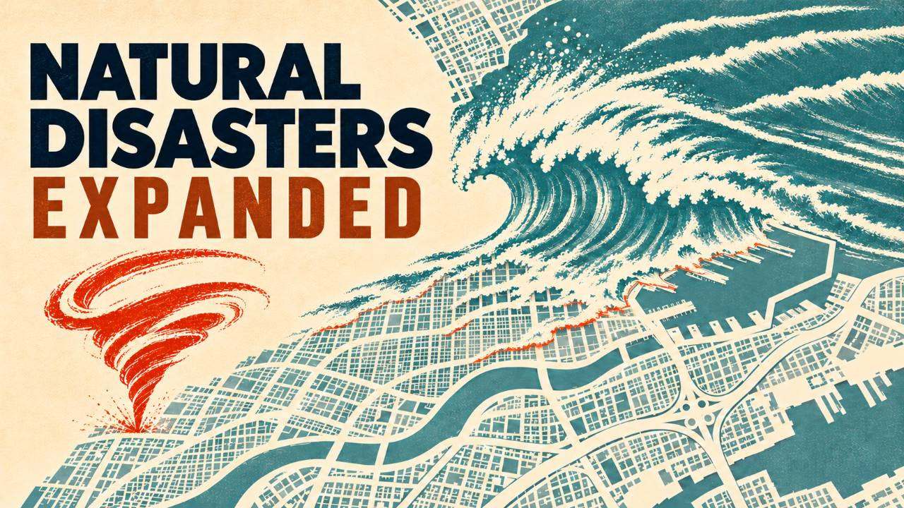

**Miss the moment in Cities: Skylines I's Natural Disasters when you had to decide whether to evacuate? Bring that feeling to Cities: Skylines II, and stay for what happens after the sirens.**

Command **six disasters** and build your response around **eight assets** — four placeable facilities and four custom vehicles. Watch a National Guard relief truck take up a post outside a hospital, a recovery crew reopen a school, or a relief helicopter lift off when the roads are jammed. After a mass-casualty event, a mortuary van can collect up to four deceased residents in one trip.

Send a tsunami into the waterfront, choose where an earthquake splits the ground, or watch snow close the highway your ambulances depend on. You choose when to give the warning, who should travel to a shelter, and who should stay indoors.

Afterward, the city has work to do. A recovery truck can get a damaged school back into service. A displaced family might return to its former address. And when the last warning disappears, a mortuary van may still be making its rounds.

*Upgrading from an earlier version? Open the construction toolbar and choose Disaster Control, the same category where you place the game’s emergency shelters. Look for the Disaster Recovery & Air Support Center, Community Emergency Shelter, National Guard Disaster Support, and Public Cooling Center (requires Creator Pack: Leisure Venues). You can keep your existing recovery depot. To add the rooftop helicopters, ambulances, and mortuary vans to your city, place the new combined center.*

## Choose your disaster

### Tornadoes: a skyline-changing encounter

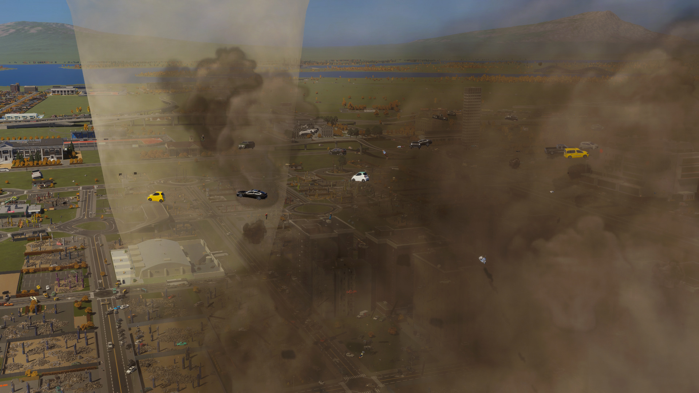

Set the intensity and watch a tornado tear through the city. Exposed people and vehicles can be pulled into its circulation and thrown across the landscape. Buildings take damage according to exposure and resistance: small homes are vulnerable, while stronger tornadoes can threaten much larger structures. Forests can be stripped or flattened, with recovery for eligible damaged trees.

Strength matters. A weak tornado and a strength-10 tornado should present very different problems for your emergency services—and for anyone caught outside.

### Tsunamis: the waterfront is only the beginning

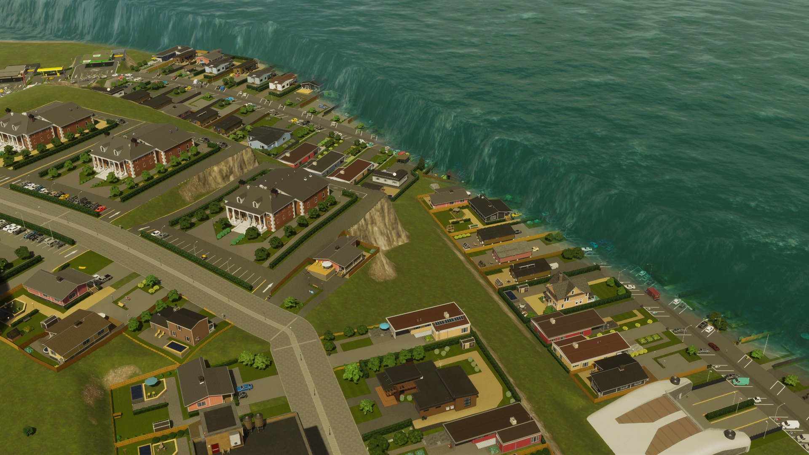

Choose a water source, adjust the wave, and send flooding toward the city. Water can push inland, sweep people and vehicles away, flatten trees, and damage or collapse buildings. Severe inundation can threaten even substantial structures.

The starting setup is a **2,000 m source front with a 30 m source rise**. Shoreline orientation is assisted, with manual control available for more deliberate setups. The resulting wave depends on water depth, coastline and terrain: the source-rise setting is not a promise of that exact water height at every building.

### Hurricanes and the race to landfall

Choose the stretch of coast you want to threaten. The point you pick is the hurricane's destination on its approach. The storm enters from a suitable offshore map edge and tracks toward that point, crossing islands or peninsulas along the way. Follow the eye marker and its heading to see which neighborhood is next. The event card shows the approach and projected landfall. As the center travels inland, the winds gradually weaken.

**The waterfront can flood before the eye arrives.** Onshore winds push up water along suitable parts of the coast as the center moves. The front-right quadrant generally produces the strongest surge. The rise accelerates briefly around peak strength and the storm releases its pressure as it fades. At strength 10, the source-rise target reaches **15 m**. Inland water still needs somewhere to drain.

**Watch the trees as the wind picks up.** Light and moderate storms can strip leaves. At strengths **7–10**, trees caught in the most intense winds can fall permanently. The moving core concentrates structural wind damage within the inner **30% of the configured wind radius**. Buildings at least **100 m tall** have protection from hurricane-attributed collapse. Floodwater has its own reach and timing. For a second challenge, enable the optional weak tornadoes before starting the hurricane.

Look for the open eye inside a rotating eyewall. Spiral bands wrap around it, and the strongest storms build a broader, denser cloud shield. From a shoreline or an overhead view, the orange eye marker helps you follow the center through rain and cloud. Visibility depends on the game's volumetric graphics settings.

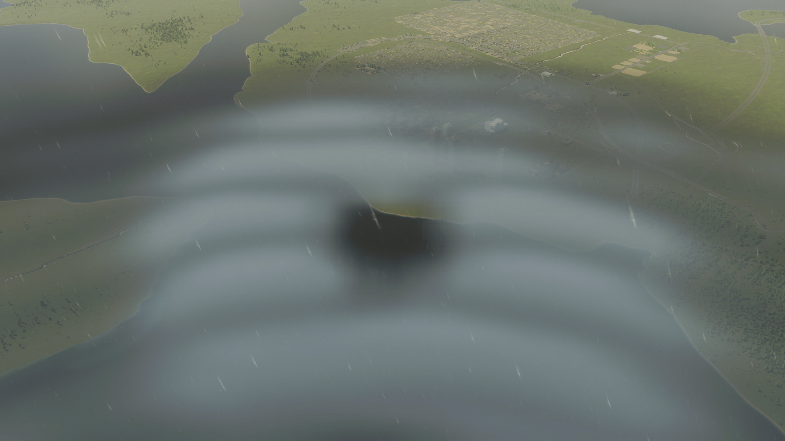

### Earthquakes that leave a mark

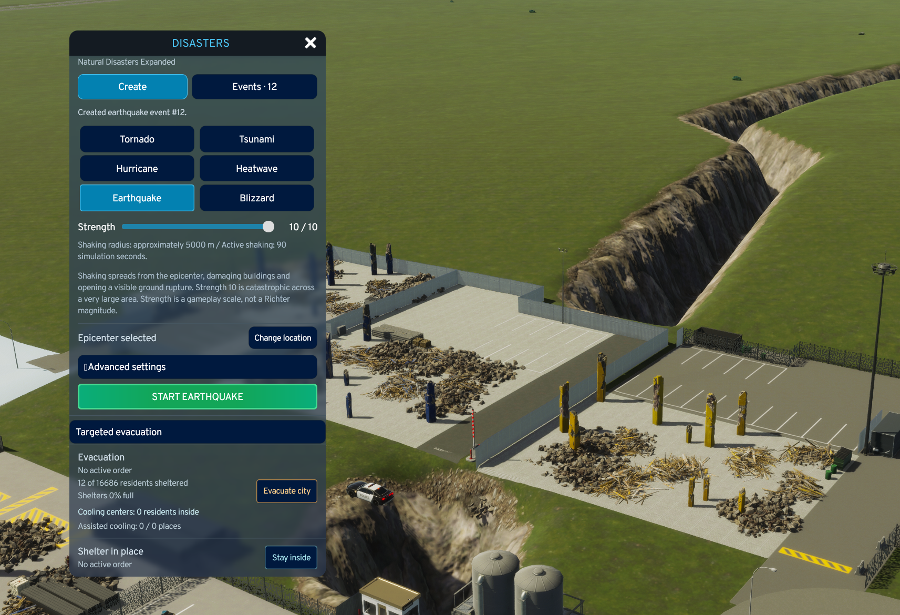

Pick an **epicenter** on the map. The preview shows the reach of the shaking, from roughly **250 m at strength 1** to **5 km at strength 10**. Change the fault direction in Advanced settings to aim the rupture across a field, a neighborhood or the road your city relies on.

Watch the buildings closest to the epicenter as the shaking builds, peaks and eases. At strength 10, the shaking reaches **5 km** from the epicenter, while collapses from shaking concentrate within **1.1 km** of the center. Buildings farther out can still take damage. At strengths **9–10**, a building whose foundation straddles the opening fault can also collapse along the rupture. Buildings already driven to failure can give way for up to **10 simulation seconds** after shaking stops.

The ground itself opens progressively. At strength 10 the fissure can reach roughly **144 m across and 60 m deep** in its widest, deepest stretch, tapering toward the tips. Surface roads it cuts can lose a segment. Survey the damage, rebuild the crossing or find a new route. The split remains in the terrain after the event. You can turn off camera tremor in the mod settings.

### Blizzards that can stop a city

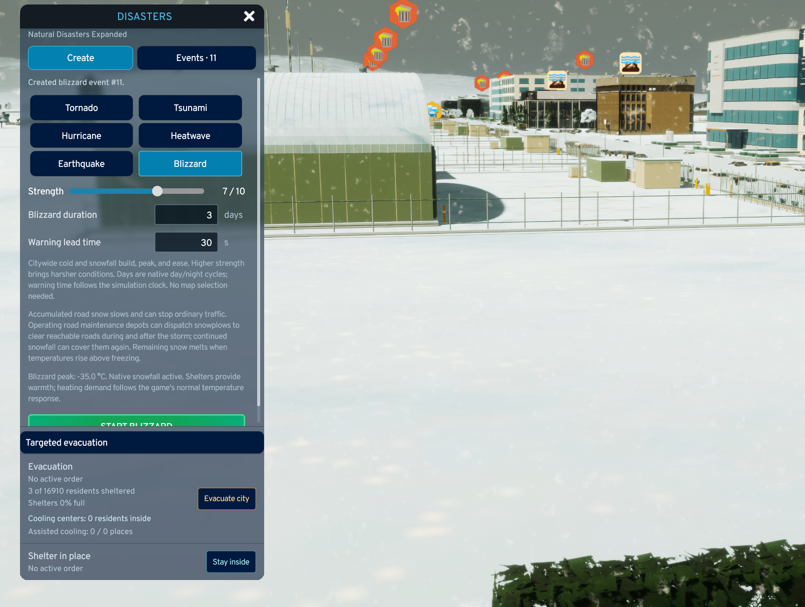

A flat, warm map can have its own snow emergency. Set the **strength**, **warning time** and **duration**. As the temperature falls, snowfall builds citywide and a moving band brings deeper drifts. People caught outside can suffer cold exposure. Ordinary traffic slows as road snow builds and can grind to a halt in deep sections.

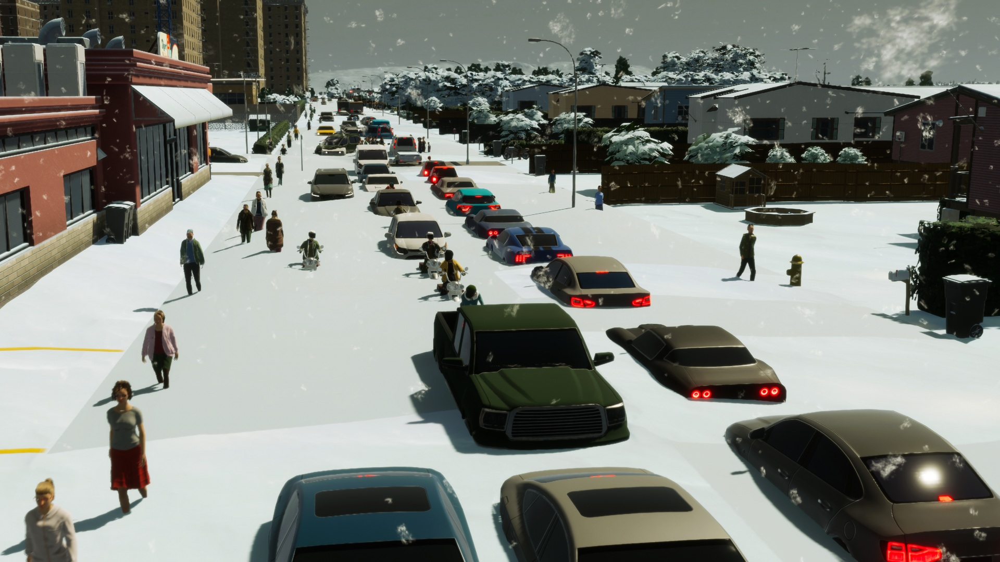

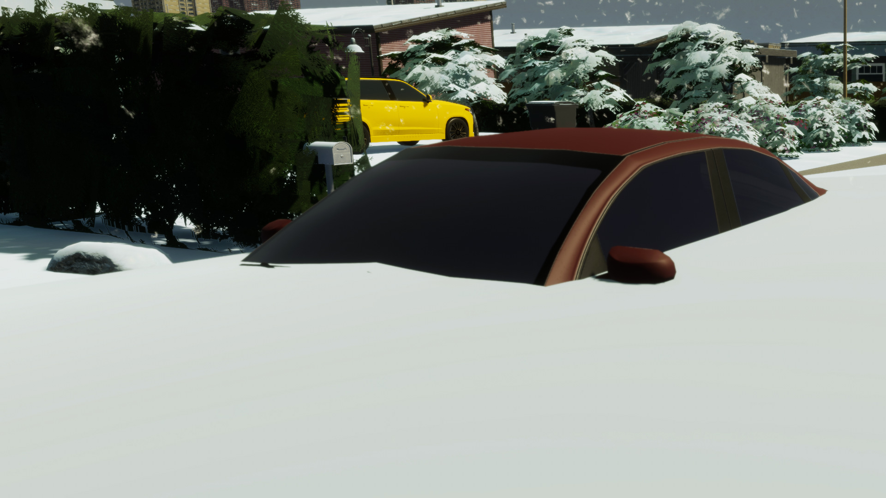

Give your **Road Maintenance Depot** a working road connection. A snow-equipped maintenance vehicle can be dispatched to a reachable snowy road and clear sections as it drives. The road snow follows the curves of roundabouts as well as the straight approaches. Traffic through a cleared section responds to the reduced depth. Continued snowfall can cover the route again, and residual snow melts once temperatures rise above freezing.

### Heatwaves: the quieter disaster

Temperature rises toward an intensity-dependent peak, exposing residents to heat stress and potential illness. Warming ramps up over no more than one in-game day/night-cycle hour, and the weather presentation adds a restrained hot-weather atmosphere whose appearance depends on daylight and existing weather.

Give exposed residents a nearby place to cool down, and keep medical services available for those who become ill. Cooling visits are preventive support for eligible residents; seriously ill citizens still need medical care.

## Get people to safety—and decide when it is safe to return

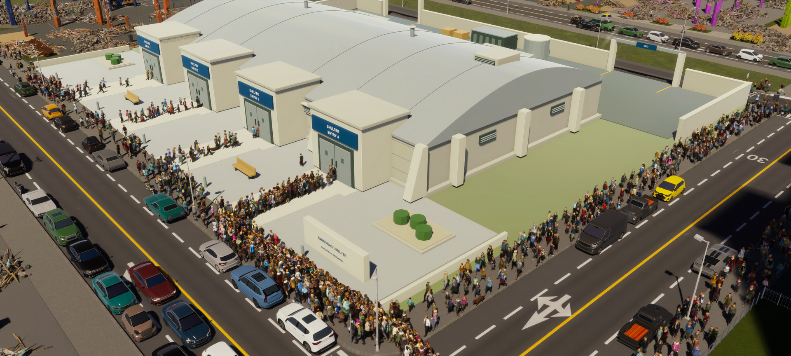

Open **Disasters** and choose the order that fits the threat. Starting or ending a hazard is separate from issuing or lifting an order.

- **Evacuate city** sends eligible residents toward emergency shelters. For a smaller incident, select a district, set a radius, or draw an area. Use **All clear** to withdraw the evacuation.
- **Shelter in Place** issues a separate citywide order. People already indoors can stay there, and eligible pedestrians outdoors seek nearby public buildings or businesses. It also holds routine departures and new arrivals. Vehicles and passengers already traveling can still be visible. Use **Lift order** to release these holds. Urgent medical transport, evacuation and escape from an unsafe building can still take precedence.

With an operating National Guard base, **Shelter in Place** also calls Guard trucks to roadside posts near eligible critical facilities. The panel distinguishes deployed trucks from facilities actually covered. You can lift Shelter in Place while leaving an evacuation in force, or issue All Clear while keeping Shelter in Place active.

Police have a different job during the order. Available ground patrol cars can circulate between reachable street addresses in their stations' service areas, with flashing lights while on patrol. Emergency calls still take priority. Up to four nearby patrol cars can sound positional sirens when their vehicle models provide a compatible audio effect.

Follow the number of residents physically sheltered, the city population, and overall shelter fullness. Shelters retain finite capacity. An order starts journeys through the actual city; it does not instantly move everyone indoors.

All Clear releases residents whose circumstances allow them to leave. A household whose home was destroyed may still need accommodation, and a flooded shelter must keep people protected until access is safe. Temporary accommodation defaults to **90 in-game day/night cycles**, with an adjustable stay limit. Housing recovery seeks suitable homes and can return still-displaced households to a rebuilt former home when it is available, without displacing its new tenants.

## Build your response network

Find these four core facilities in the construction menu's **Disaster Control** category. Each has a different job; place them before you need them and give them dependable road access.

### Disaster Recovery & Air Support Center

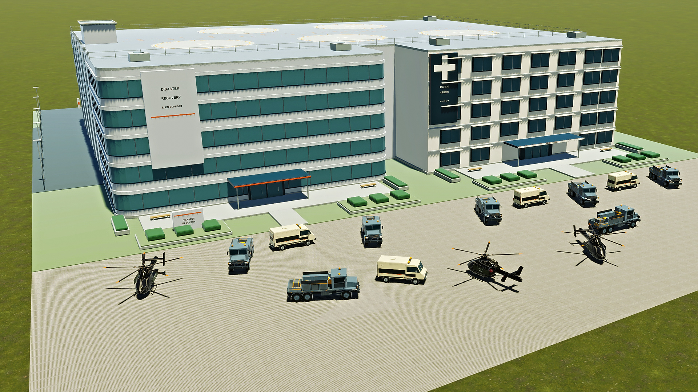

**Your main base for the aftermath.** This combined campus brings ground recovery, medical support, aviation and mortuary transport together, with a recognizable hospital wing, recovery garages and five rooftop helipads.

Five fleets share the campus. Each handles a different part of the aftermath.

- **20 recovery trucks** to clear rubble and help restore damaged service buildings.
- **6 wreck-clearance vehicles** handle damaged cars. When a tornado leaves a street full of wrecks, these are the vehicles that can help clear it.
- **30 ambulances** add ground transport for living patients when local clinics and hospitals face a rush of calls.
- **5 medical helicopters** operate from the rooftop pads. Air dispatch gives living patients another route to care when roads are congested.
- **30 recovery mortuary vans**, with capacity for **four deceased residents per van**. Ordinary city hearses retain their normal capacity.

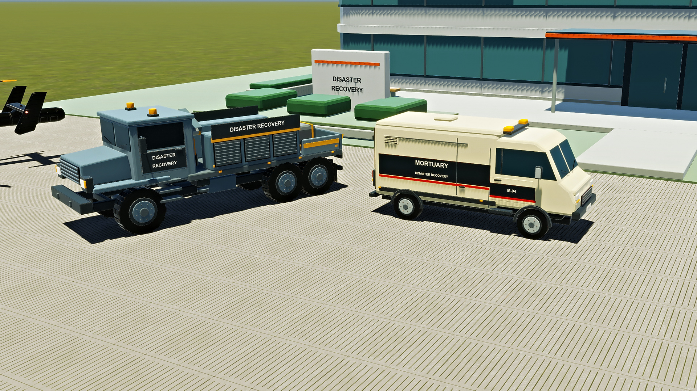

**Why send a mortuary van?** After several buildings collapse on the same block, one van can collect up to four deceased residents before returning to the recovery center. That gives the city extra pickup capacity precisely when its regular hearses are busiest. The center has morgue intake for returning vans. Your cemeteries and crematoriums continue providing burial and cremation.

Crews prioritize restoring eligible manually placed service buildings—such as hospitals and schools—after real clearance work, so those facilities can resume service without a separate manual Rebuild click. Ordinary zoned homes and businesses continue through rubble clearance and normal city redevelopment.

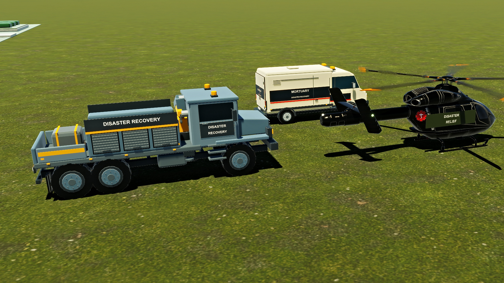

Helicopters carry living patients. Deceased collection is handled by the mortuary vans and other deathcare services. Connect the front public entrance and rear service side to roads. Fleet capacity is not a promise that every vehicle will launch at once: staffing, budget, available jobs, road access and native dispatch still matter.

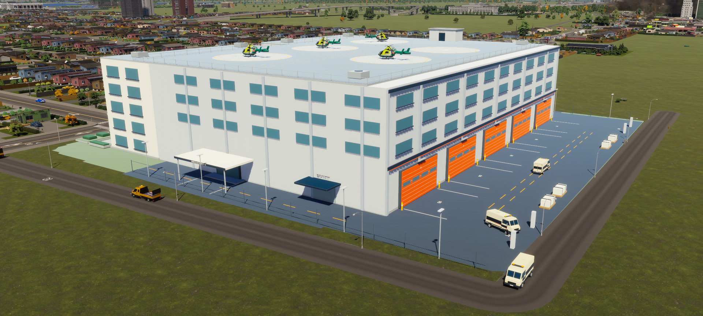

*The service side of the campus, captured in game. The building combines the roles previously provided by separate ground-recovery and air-support facilities.*

### Community Emergency Shelter

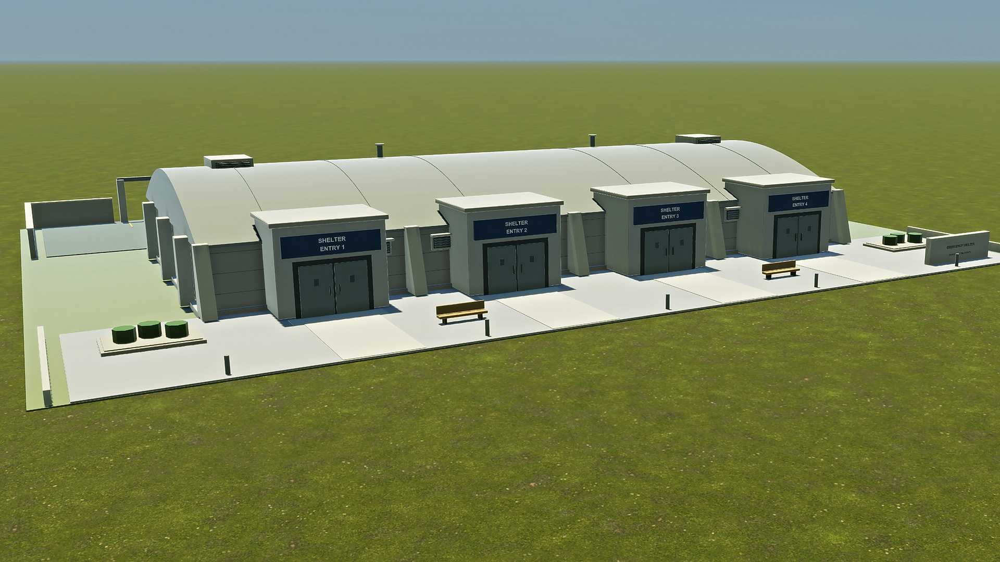

**A place for your residents to weather the disaster—and its aftermath.** The reinforced shelter has four pedestrian entrances across the front, with vehicle service access at the rear. That separates the designed pedestrian approaches from the service yard; the roads around it still need to handle the evacuation.

It provides shelter during active orders and temporary accommodation for eligible displaced residents. Occupants receive flood protection while inside, with entry and exit held when flooding makes access unsafe. Medical exceptions remain part of the accommodation rules.

**Placement tip:** connect both the front pedestrian side and rear vehicle access to suitable roads. Give the shelter several useful approaches through the surrounding neighborhood rather than funneling the entire district through one crossing.

### National Guard Disaster Support — Field Response Base

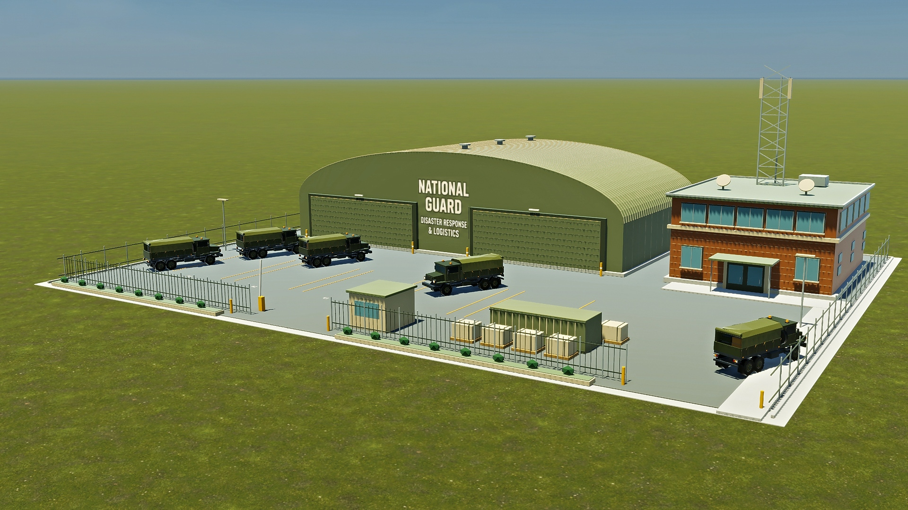

**Bring in additional ground support when one response base is stretched thin.** The Guard facility has capacity for **30 road-response relief trucks**, with a hangar, command post and fenced apron for staging.

Use it to supplement ground recovery and to staff roadside posts during **Shelter in Place**. Trucks can stop near hospitals, schools, shelters, utilities and other eligible service buildings. A truck needs an available crew and a reachable post. Coverage counts after arrival. Lifting the order recalls the trucks, and urgent rescue work can interrupt a posting. The visible Guard presence is the vehicle itself.

### Public Cooling Center

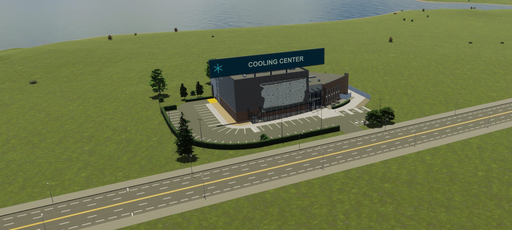

**When the forecast is relentless, give residents somewhere to cool down.** This adapted venue has a prominent rooftop sign, **500 assisted cooling-visit slots** and a staffing target of **20 workers**.

Select a center to see its occupancy, or check the Disaster Control panel for the citywide picture. People physically inside, assisted visits and inbound journeys are distinguished, so a reservation is not mistaken for someone already safe indoors. Ordinary venue visitors are separate from the assisted-visit limit.

Build centers where residents can reach them. Cooling visits target eligible exposed residents; they do not replace hospitals or override a necessary medical journey. **The current cooling-center building requires Creator Pack: Leisure Venues.**

## Recovery means more than clearing the map

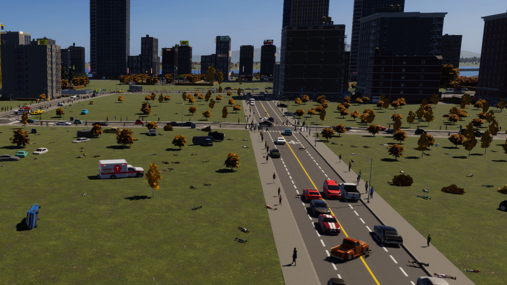

Disaster casualties are retained for actual collection and delivery through deathcare services. Nearby pickup assistance helps eligible assigned responders reach casualties, and the dedicated mortuary vans can carry several deceased residents on one trip.

Emergency-response improvements use native priority and legal route handling where available. They do not turn ambulances or hearses into vehicles that can drive through every obstruction. Road layouts, damaged vehicles and overwhelmed service fleets can still create a difficult recovery.

This update also reduces repeated shelter and casualty bookkeeping, improves All Clear processing, and repairs a specific broken hearse-assignment state. These changes preserve actual admissions and pickup rather than clearing the backlog by silently deleting people.

## Keep the event history

The **Events** view lists disasters newest first. Review attributed building destruction, deaths, injuries and other available impact figures, with supported late updates during recovery. Totals reflect observed, attributed outcomes; they are not calculated just from the size of a visual effect. Where a cost estimate is unavailable, it is shown as unavailable.

## Your first emergency

1. Place a Community Emergency Shelter and a Disaster Recovery & Air Support Center. Connect their access points and allow staffing to establish.
2. Add National Guard Support for extra ground recovery, or a Public Cooling Center for heatwave preparedness.
3. Open Disaster Control, select a hazard, and adjust its intensity and relevant settings.
4. Choose **Shelter in Place** when routine travel would expose people, or evacuate residents who need shelter. Follow the order status, shelter occupancy and event report as the disaster unfolds.
5. Withdraw each active order when conditions allow. Give emergency vehicles access to casualties and damaged facilities while displaced households seek accommodation and housing.

## Frequently asked questions

### Where do I start—and where are the buildings?

Open the **Disasters** button for hazard controls, evacuation orders and event reports. Find the mod's facilities in the construction menu's **Disaster Control** category. Start with a Community Emergency Shelter and a Disaster Recovery & Air Support Center, connect their access points, and give them time to acquire staff.

### Do I need every facility?

Each fills a different role. The **shelter** protects evacuees and accommodates eligible displaced households. The **combined recovery center** supplies ground recovery, medical response, helicopters and mortuary transport. **National Guard Support** adds ground recovery capacity. The **cooling center** helps eligible residents during heatwaves. Build the response network your city needs; the Guard base does not replace shelter or medical capacity.

### I pressed All Clear. Why does Shelter in Place still say active?

They are two independent orders. **All clear** withdraws evacuation to emergency shelters. **Lift order** ends the citywide instruction to remain indoors. If both are active and you want normal routines to resume, withdraw both. The order panel shows which one is still in force.

### Why can I see cars moving during Shelter in Place?

People already aboard vehicles continue under the game's transport rules. Medical pickups, evacuation from danger and response traffic also continue. Shelter in Place progressively holds eligible routine departures, including school trips, and pauses new household, tourist and commuter arrivals. If a student at a safe home starts a new trip after the order has taken effect, the resident's origin, destination and order status are useful details to include in a report.

### What brings the Guard trucks out?

Place and operate **National Guard Disaster Support**, issue **Shelter in Place**, and allow time for dispatch and travel. Trucks need reachable critical facilities and suitable roadside posts. Some capacity stays available for urgent rescue. A second Guard base adds available capacity, while the number of sites needing coverage also affects how many vehicles you see.

### Why did a police car pass one address and head toward another?

During Shelter in Place, that can be a surveillance patrol. Eligible ground cars take successive patrol legs between reachable streets in their station's operating area. Police stations supply these cars independently of the Guard base. Staffing, vehicle availability, native shifts, urgent calls and traffic still affect deployment. Lights identify an active patrol, while sirens depend on proximity and the vehicle's available audio effect. When you lift the order, a car can finish its current leg before resuming ordinary service.

### Can a blizzard work on a map that never gets winter?

Yes. Start **Blizzard** from Disaster Control, set a strength and duration, and let the simulation advance through the warning. The storm supplies its own cold and precipitation. A heatwave or another mod controlling the same weather settings can prevent it from starting. Snow visuals also depend on the game's graphics options.

### Do I have to buy a special plow? How do I tell if it is clearing?

Use an operating **Road Maintenance Depot** with a snow-capable vehicle. Snowy roads request service, so dispatch takes time and depends on access and available vehicles. Follow an assigned plow along a snowy road. The mod tracks four sections per road segment, so clearing can show up section by section behind a moving truck. A thin winter coating can remain after the deeper drift clears. A stationary vehicle, a returning truck or a plow blocked in traffic can leave snow on the road.

### Why does an earthquake leave a broken road after I end the event?

New earthquakes can cut the actual terrain and interrupt intersecting surface roads. Look for a missing connection along the fault and rebuild or reroute it as needed. Strength measures gameplay severity on a 1–10 scale. The radius preview shows possible shaking, and individual building outcomes vary within it.

### Can surge arrive while the hurricane is still offshore?

Yes. A new hurricane can raise coastal water wherever its moving winds push onshore. The strongest structural wind damage follows the center more closely. Use the eye marker for the storm's location and watch the waterline for flooding. Already-active hurricanes loaded from an older save can retain their original surge source.

### Why does the hurricane ask me to change the target?

A new hurricane needs a route from an offshore map edge and enough room for its surge front at the selected coastal water. Try a different coastal point, narrow the source front, or increase storm speed so the eye can reach the target during the event. **Change location** lets you choose again. Exit Photo Mode before picking a point on the map.

### Why are Tsunami and Hurricane unavailable?

Open **Options → Natural Disasters Expanded → Enable tsunamis**. Both hazards use the game's water simulation. Return to Disaster Control, choose a hazard, and use **Select on map** to pick suitable offshore water. If the panel gives a placement warning, adjust the origin or front width until the source fits.

### Why aren't all the emergency vehicles leaving at once?

A fleet number is capacity, not a command to launch every vehicle. Dispatch depends on suitable jobs, available vehicles, staffing, budget, service coverage and reachable destinations. Check the building's access and operating status first. Persistent empty returns, disappearing vehicles or ignored reachable jobs may be bugs—please report them rather than assuming they are intended.

### I already have a cemetery or crematorium. What does the mortuary van add?

Extra vehicles and more room per trip during a disaster. Build the **Disaster Recovery & Air Support Center** to add its mortuary fleet. The vans dispatch automatically. A van with space can continue to another eligible nearby pickup, so several casualties on one block can share a trip. Ordinary hearses keep their usual capacity. A van may return with fewer than four people when another pickup is unavailable.

### Why are bodies still waiting for a hearse?

Collection requires an available deathcare provider, an assigned vehicle, access to the casualty and space for transport and delivery. A large disaster can overwhelm that chain even after rubble is cleared. The mod's recovery mortuary vans have **four deceased-person slots**; ordinary city hearses keep their native capacity. Four slots do not guarantee four pickups on every trip. If nearby casualties remain unassigned despite available services, that is useful bug-report evidence.

### What about cars thrown into fields or other undeveloped areas?

The new roadside recovery system lets eligible maintenance vehicles seek a reachable stopping point within **80 metres** of a disaster wreck, then perform the game's timed recovery work. It requires a safe ground approach; occupied, burning or flooded wrecks cannot use this assistance. Cars farther away or behind obstacles may remain inaccessible. This is roadside work, not a new animated winch or a guarantee that every wreck can be recovered. Its latest in-game behavior is still being checked.

### Does All Clear send everyone home immediately?

It ends the evacuation order; it does not teleport people. Residents need time and usable routes to change journeys. Households with destroyed homes may still need temporary shelter, and flooded access can delay entry or departure. Someone with a usable home persistently following an old evacuation order is a different issue and should be reported. A confusing activity label alone does not establish where a resident is actually going.

### Do recovery crews automatically rebuild everything?

No. Recovery prioritizes **eligible manually placed service buildings**, such as hospitals and schools, with automatic restoration after real clearance work. Zoned homes and businesses use rubble clearance followed by normal city redevelopment. A truck visiting a site is not proof that clearance or restoration has finished. If an eligible cleared facility still requires a manual Rebuild click, please include the building name in a report.

### Can the helicopters collect deceased residents?

**The current medical helicopters transport living patients.** Mortuary vans and other deathcare services handle deceased collection. Broader aircraft recovery roles remain future work; five rooftop pads do not mean five aircraft will launch without suitable medical assignments.

### Why won't my heatwave start—or why is the temperature different from what I expected?

Another weather mod may be holding a temperature override. If Disaster Control reports that conflict, release the competing override first. Once a heatwave starts, warming ramps toward its target rather than changing instantly. Cooling visits help eligible exposed residents; they are not a command for every citizen to become sick or visit a center.

### Why can't I find the Public Cooling Center?

The current building uses content from **Creator Pack: Leisure Venues**, which must be available. Look in the Disaster Control construction category. It provides **500 assisted cooling-visit slots** with a staffing target of **20 workers**. Assisted reservations, people on their way, people inside and ordinary venue visitors are different counts; the selected-building panel and Disaster Control help distinguish them.

### Will an update remove my older buildings or trucks?

Legacy facility and vehicle definitions are retained for existing saves, even when those buildings are hidden from the new-construction menu. Existing trucks can finish their service, and new dispatches can use the updated disaster recovery truck. Keep a backup save before updating. Removing the mod entirely is different from updating it and is not a supported way to migrate a city containing its assets.

### Why can a major disaster slow my city down?

Evacuation journeys, damaged buildings, casualties and recovery dispatch all add simulation work. Low overall CPU usage does not prove the simulation has spare capacity: work can be limited by individual threads or systems waiting on each other. Optimization reduces repeated processing, but a mass-casualty event can still be expensive. Lowering the simulation speed may make play more manageable; it does not resolve an underlying bug.

### What makes a useful bug report?

Use the **Report a bug** link below. Include your game and mod versions, enabled playset, what you expected, what happened, and the steps that reproduce it. Add the event number for incorrect disaster totals, or the selected building/vehicle/resident details for recovery issues. Screenshots and relevant game/mod logs help; a copy of the affected save can help when practical. Please review files for personal information before sharing them, and keep your original save.

## Practical notes, compatibility and support

- **Existing cities:** previously placed standalone recovery centers, air-support buildings and retired annexes retain their registered assets for save compatibility. The streamlined construction menu focuses on the four core facilities above.
- **Water:** source rise is not a guaranteed coastal wave height. Flooding can remain in low ground after a tsunami or hurricane ends; faster source release does not instantly drain inland basins.
- **Weather controls:** another mod holding a temperature override can prevent a heatwave from starting. Release that override first.
- **Traffic and cleanup mods:** mods that alter routing, pedestrian priority, despawning or casualty cleanup can affect recovery. If behavior changes, include your playset when reporting it.
- **Performance:** large evacuations and mass-casualty disasters add work to both this mod and the game's simulation. The optimization work reduces repeated processing; it does not guarantee normal speed during every city-scale emergency.
- **Current limits:** drawn tornado routes and the visible funnel do not precisely define every impact; difficult dispatch cases and incomplete late attribution can still occur. Cooling uptake and heat-related illness remain areas of active refinement.
- **DLC and saves:** Creator Pack: Leisure Venues is needed for the current Public Cooling Center. Keep a separate save before introducing major disasters. Removing the mod from a city that uses its custom assets is not a supported save migration.

This is an unofficial community mod for Cities: Skylines II. The asset photographs above are actual in-game captures; the cover is promotional artwork.

[Report a bug](https://github.com/jclark50/natural-disasters-expanded-support/issues/new?template=bug_report.yml) · [Known limitations](https://github.com/jclark50/natural-disasters-expanded-support/blob/main/KNOWN_LIMITATIONS.md)

## Upcoming Features

Future work under consideration includes the following.

- **Meteor strikes and volcanoes.** A targeted meteor with a crater and an outward shockwave, and a volcano whose uplift and lava follow the terrain, are planning concepts for future disasters.

- **More dependable casualty and wreck recovery:** improve provider matching, empty-return cases, difficult off-road pickup and recovery throughput while preserving real collection.
- **Better emergency access:** refine response through heavy congestion, without the airborne vehicles or abrupt despawning that experimental movement approaches can cause.
- **Heatwave depth:** refine cooling uptake and health effects, then explore electricity-demand spikes and rolling blackouts.
- **More useful National Guard operations:** expand coordinated response, convoy behavior and possible temporary disaster-area cordons.
- **Recovery aviation:** investigate broader recovery roles, including deceased transport, separately from the current living-patient helicopter service.
- **Evacuation and aftermath refinement:** improve crowded approaches, household recovery and access to damaged areas; explore private-car evacuation later.
- **Presentation and performance:** polish hurricane wind-field visuals, asset and vehicle detail, and the cost of large-city recovery. Improve residual flooding where it can be done without damaging ordinary rivers and lakes.

These are development priorities, not features promised as complete in this update or a fixed release schedule.
